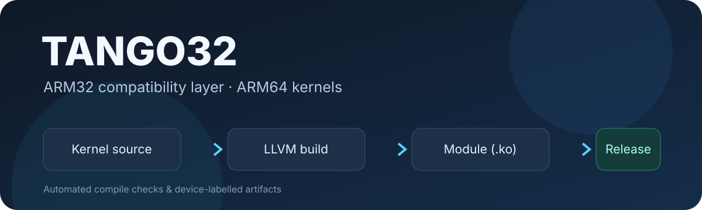

<div align="center">

# Tango32 ARM64 Module

**ARM32 compatibility support for ARM64-only Android kernels**

[](https://github.com/NEXTDROIDER/tango32-module/actions/workflows/c-cpp.yml)
[](https://github.com/NEXTDROIDER/tango32-module)
[](https://github.com/NEXTDROIDER/tango32-module)
[](COPYING)



</div>

## About

This repository contains the Tango32 kernel module used by the [Tango binary translator](https://www.amanieusystems.com/). Tango translates 32-bit ARM programs so they can run on 64-bit-only ARM processors. The module provides kernel-side support for 32-bit system-call behavior that cannot be fully handled in userspace.

The module exposes its interface through ioctl operations on `/dev/tango32`.

> **Status:** builds are automated as compile-checks against selected kernel source. A successful compile is not proof that the module can be loaded on a device.

## Highlights

- ARM64 kernel-module build pipeline using Clang/LLVM.
- Select kernel repository and branch when starting a workflow.
- Device-model-labelled releases for successful builds.
- Releases are deduplicated by **device model + kernel source commit**.
- Build artifacts include the module, kernel config, kernel release, and build metadata.
- Vendor Kconfig entries absent from a source checkout are skipped only for the generic CI compile-check.

## Build in GitHub Actions

1. Open **[Actions → Tango32 ARM64 kernel module build](../../actions/workflows/c-cpp.yml)**.
2. Press **Run workflow**.
3. Enter the phone/device model (for example, `OPPO CPH2819`).
4. Choose the kernel repository and branch.
5. Start the run and wait for the build.

Default source:
- Repository: `oppo-source/android_kernel_oppo_sm6225`
- Branch: `oppo/sm6225_b_16.0`

### Automatic releases

After a successful compile, the workflow creates a GitHub Release if that exact device-model/kernel-source-commit combination has not already been released. Tag format:

```
tango32-<device>-<kernel-release>-<commit>
```

Release assets:
- `tango32.ko` — compiled module
- `build-info.txt` — source, commit, compiler and build details
- `kernel-release.txt` — kernel release string
- `kernel-config.txt` — compile-check configuration
- `tango32-build-bundle.tar.gz` — bundled files

Browse **[Releases](../../releases)**.

## Compatibility notes

- Upstream project notes Linux kernel **5.6 or newer** as the supported baseline; older kernels have partial/unsupported compatibility.
- This workflow prepares a generic ARM64 configuration and disables `CONFIG_MODVERSIONS` for compile-check. Therefore the output is **not guaranteed to load on your phone**.
- An installable module must be built against the exact device kernel source, configuration, toolchain, generated headers and symbol-version data.
- Do not force-load on a daily-use device without a recovery plan. Kernel modules can crash or boot-loop a device.

## Screenshots / build preview

There are no verified device screenshots yet. The banner above is an illustration of the build/release pipeline, not a screenshot of a running module. Real device screenshots and test results will be added when documented.

## Source & license

This repository is based on the Tango32 kernel-module source. See [COPYING](COPYING) for the license and [Amanieu Systems](https://www.amanieusystems.com/) for the translator.

---

<div align="center">Experimental · Android kernel development · ARM64</div>
