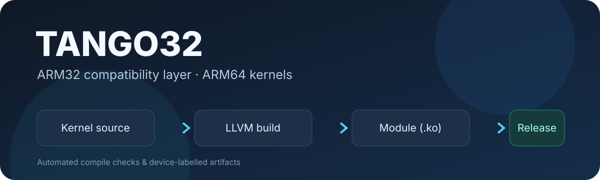

<div align="center">

# Модуль Tango32 для ARM64

**Поддержка совместимости с ARM32 в Android-ядрах только для ARM64**

[](https://github.com/NEXTDROIDER/tango32-module/actions/workflows/c-cpp.yml)
[](https://github.com/NEXTDROIDER/tango32-module)
[](https://github.com/NEXTDROIDER/tango32-module)
[](COPYING)



</div>

**Язык:** 🇷🇺 Русский · [🇬🇧 English](README.md)

## О проекте

В этом репозитории находится модуль ядра Tango32, используемый транслятором [Tango](https://www.amanieusystems.com/). Tango переводит 32-битные ARM-программы, чтобы они могли работать на 64-битных ARM-процессорах. Модуль обеспечивает поддержку со стороны ядра для поведения 32-битных системных вызовов, которое невозможно полностью реализовать в пользовательском пространстве.

Модуль предоставляет интерфейс через ioctl-операции устройства `/dev/tango32`.

> **Статус:** автоматическая сборка выполняется как проверка компиляции для выбранного исходного кода ядра. Успешная компиляция не означает, что модуль можно загрузить на конкретном устройстве.

## Возможности

- Сборка модулей ядра ARM64 с использованием Clang/LLVM.
- Выбор репозитория и ветки ядра при запуске workflow.
- Отдельные релизы с указанием обнаруженной модели устройства.
- Релизы не дублируются для одной и той же **модели устройства и коммита исходников ядра**.
- Артефакты содержат модуль, конфигурацию и версию ядра, а также метаданные сборки.
- Отсутствующие в исходниках vendor-записи Kconfig пропускаются только для общей CI-проверки компиляции.

## Сборка через GitHub Actions

1. Откройте **[Actions → Сборка модуля ядра Tango32 для ARM64](../../actions/workflows/c-cpp.yml)**.
2. Нажмите **Run workflow**.
3. Укажите модель телефона (например, `OPPO CPH2819`) или введите `all`, чтобы просканировать совместимые идентификаторы OPPO в дереве устройств выбранного исходного кода ядра.
4. Выберите репозиторий и ветку ядра.
5. Запустите workflow и дождитесь компиляции и публикации релизов.

Исходный код по умолчанию:
- Репозиторий: `oppo-source/android_kernel_oppo_sm6225`
- Ветка: `oppo/sm6225_b_16.0`

### Автоматические релизы

После успешной компиляции обычный режим создаёт GitHub Release для указанной модели. При `device_model=all` workflow сканирует файлы device tree выбранного исходного кода, находит совместимые идентификаторы OPPO и создаёт отдельный релиз для каждого обнаруженного идентификатора. Релизы, уже опубликованные для того же коммита ядра, пропускаются.

**Важно: это только маркировка релизов по найденным идентификаторам. Модуль компилируется один раз для выбранного исходного кода и не проходит отдельную проверку для каждой модели из списка.**

Формат тега:

```
tango32-<device>-<kernel-release>-<commit>
```

Файлы релиза:
- `tango32-<device>-kernelsu.zip` — ZIP-модуль для установки через KernelSU (рекомендуется)
- `tango32.ko` — скомпилированный модуль
- `build-info.txt` — исходный код, коммит, компилятор и сведения о сборке
- `kernel-release.txt` — строка версии ядра
- `kernel-config.txt` — конфигурация для проверки компиляции
- `tango32-build-bundle.tar.gz` — архив со всеми файлами сборки

Смотрите **[все релизы](../../releases)**.

### Вашего телефона нет среди релизов?

Если вашей модели телефона нет в списке релизов, пожалуйста, **[создайте Issue](../../issues/new/choose)**. Укажите:

- Точную марку и модель телефона (например, OPPO CPH2819).
- Версию Android и версию ядра (`uname -r`).
- Ссылку на исходный код ядра устройства, если она доступна.

Эта информация поможет нам изучить возможность поддержки устройства и добавить подходящую сборку, если исходный код ядра доступен. Создание Issue не гарантирует поддержку устройства или возможность собрать совместимый модуль.

### Установка модуля KernelSU

1. Скачайте файл `tango32-<device>-kernelsu.zip` из GitHub Release для своего устройства.
2. Откройте KernelSU Manager → **Modules** → **Install from storage** и выберите ZIP-файл.
3. Установщик проверит архитектуру ARM64 и потребует точного совпадения `uname -r` телефона со строкой версии ядра, для которой собран модуль. Если версии различаются, установка будет остановлена.
4. Перезагрузите телефон. При загрузке модуль автоматически попытается загрузиться. Чтобы посмотреть статус и логи, откройте кнопку **Action** модуля в KernelSU.

ZIP содержит модуль, проверки установщика, скрипт загрузки при старте системы, просмотр статуса и очистку при удалении. Совпадение строки версии ядра — лишь базовая проверка безопасности; оно не доказывает совпадение всех символов и параметров конфигурации ядра.

## Совместимость и предупреждения

- В исходном проекте в качестве базовой поддерживаемой версии указано ядро Linux **5.6 или новее**; для более старых ядер совместимость частичная или отсутствует.
- Этот workflow подготавливает общую конфигурацию ARM64 и отключает `CONFIG_MODVERSIONS` для проверки компиляции. Поэтому **нет гарантии, что полученный модуль загрузится на вашем телефоне**.
- Для действительно совместимого модуля необходима сборка с точными исходниками ядра устройства, его конфигурацией, инструментарием компиляции, сгенерированными заголовками и данными версий символов.
- Не пытайтесь принудительно загружать модуль на основном устройстве без возможности восстановления. Модули ядра могут вызвать сбой или циклическую перезагрузку устройства.

## Скриншоты и демонстрация сборки

Проверенных скриншотов с реальных устройств пока нет. Баннер выше иллюстрирует процесс сборки и публикации релизов, а не является скриншотом работающего модуля. Реальные скриншоты и результаты тестирования будут добавлены после документирования.

## Исходный код и лицензия

Репозиторий основан на исходном коде модуля ядра Tango32. Условия лицензии указаны в файле [COPYING](COPYING). Информация о трансляторе доступна на сайте [Amanieu Systems](https://www.amanieusystems.com/).

---

<div align="center">Экспериментальный проект · Разработка Android-ядра · ARM64</div>
